<picture>
  <source media="(prefers-color-scheme: dark)" srcset="assets/card-dark.svg">
  <source media="(prefers-color-scheme: light)" srcset="assets/card-light.svg">
  
</picture>

<a href="https://t.me/begenFys"><picture><source media="(prefers-color-scheme: dark)" srcset="assets/btn-telegram-dark.svg"><source media="(prefers-color-scheme: light)" srcset="assets/btn-telegram-light.svg"></picture></a>&nbsp;&nbsp;<a href="mailto:nikita.perminov.work@gmail.com"><picture><source media="(prefers-color-scheme: dark)" srcset="assets/btn-email-dark.svg"><source media="(prefers-color-scheme: light)" srcset="assets/btn-email-light.svg"></picture></a>

Telegram is the fastest way to reach me · <a href="README.ru.md">Русская версия</a>

## About

Product engineer with backend depth and 4+ years of commercial experience. I build the systems a product runs on: payments and billing, support operations, internal platforms, growth tooling. I take them from requirements to production myself and keep them running after launch.

- **Money.** I built a payment gateway that routes four services to two acquirers (SBP and cards), with signed callbacks, idempotency and retries. Billing operations have idempotency keys and dry-run on every money action.
- **Operations.** I rebuilt a company's internal platform as its own system and grew it into a support desk, finance tools and planning.
- **Growth.** I built promo campaigns with segmentation and funnel analytics, plus lifecycle messaging across bot, email and the client panel.
- **AI in the loop.** I wrote an MCP server so AI agents work in internal tools with each employee's permissions. I write code with Claude Code and Codex, and tests and review keep the quality in check.

## How I can help

- **Take a product backend from v1 to production.** Data model, API, queues, payments, deploy and monitoring, owned by one person.
- **Replace a CRM or no-code patchwork with your own platform.** Move the processes over without stopping the team, then keep growing the platform with the business.
- **Put order into money flows.** Acquiring, billing, refunds, invoices for legal entities and handoff to accounting, built so a retry never charges twice.
- **Bring AI into the product and internal work.** LLM features and integrations with model APIs, agents with tool calling, and MCP servers with real auth, scopes and audit, so agents act on behalf of people and within their rights.

I'm comfortable both inside a team and leading one. For half a year I led a backend and a frontend developer: planning, code review, releases. I'm used to working directly with the business and turning its requests into tasks the team can ship.

## Experience

<b>SaaS chatbot platform</b> · Backend Developer · <i>May 2026 — now</i> Bot builder for messengers. Internal tools, product backend, client panel and monitoring.

 

- **Internal platform.** Rebuilt the company's internal platform as its own system. I own its backend: clients and payments, team and planning, notifications, role-based access and audit.
- **Support desk.** Support across messengers and email with automatic ticket assignment, escalation, SLA tracking and analytics.
- **AI agents.** An MCP server with OAuth 2.1, scopes and audit, so AI agents work in internal tools on behalf of employees.
- **Billing.** Tariff and payment operations with idempotent money actions, and invoicing for legal entities with accounting integration.
- **Growth tooling.** Promo campaigns with segmentation and funnel analytics, and lifecycle notifications across bot, email and the client panel.
- **Infra.** Docker Swarm deploys from CI, structured logs, monitoring and alerting on Prometheus, Loki and Grafana.

`TypeScript` `NestJS` `Next.js` `Prisma` `PostgreSQL` `MySQL` `ClickHouse` `Redis` `BullMQ` `MCP` `Docker Swarm` `Prometheus` `Grafana`

<b>Telecom holding</b> · Python Backend Developer · <i>May 2026 — Aug 2026</i> Internal payment gateway that routes the group's services to acquirers.

 

- Built the gateway backend. Two of us started it and I carried most of it, from design to working integrations in 3 months.
- Put two acquirers (SBP and cards) behind one internal payment contract used by 4 services.
- Secured the flow: callback signature checks, idempotent retries, an IP allowlist.
- Wrote an async status worker that retries and re-sends callbacks when external systems are down.
- Introduced cross-review and a backend repo template. Coordinated CI/CD on GitLab with three environments and Kubernetes deploys.

`FastAPI` `PostgreSQL` `RabbitMQ` `TaskIQ` `GitLab CI` `Kubernetes`

<b>Digital marketing company</b> · Python Backend Developer, Team Lead · <i>May 2023 — Apr 2026</i> Internal platforms for marketing teams: segmented messaging, single sign-on, ops automation.

 

- Led a team of two (backend and frontend) for six months: breaking down work, code review, release planning.
- Shipped a segmented push campaign system for several teams, which turned campaign launch from manual work into a few clicks.
- Built an async pipeline on RabbitMQ and TaskIQ, and sped up segment lookups several times with a Redis cache.
- Added RBAC and OAuth2 single sign-on, so onboarding a new employee takes minutes instead of a day.
- Moved background jobs from Celery to TaskIQ with retries and backoff, so failed jobs stopped needing daily manual cleanup.
- Set up CI/CD on GitHub Actions and monitoring with Prometheus, Grafana and Loki.

`FastAPI` `RabbitMQ` `TaskIQ` `Redis` `PostgreSQL` `GitHub Actions` `Grafana`

<b>E-commerce automation startup</b> · Python Developer · <i>Mar 2022 — Apr 2023</i> Tools for marketplace sellers.

 

- Built the backend on top of a marketplace's public API: data collection, price and stock management for catalogs of ~10,000 items.
- Designed an API with webhook handling, queues and async jobs. Reworking the processing logic made it about 20% faster.

`Python` `asyncio` `REST` `Webhooks`

## Stack

🐍&nbsp; **Python** &nbsp;FastAPI · asyncio · Pydantic · SQLAlchemy · Alembic · pytest 
🔷&nbsp; **TypeScript** &nbsp;NestJS · Next.js · Prisma · Socket.IO · Vitest · Jest 
🐹&nbsp; **Go** &nbsp;backend services 
🗄️&nbsp; **Data** &nbsp;PostgreSQL · MySQL · ClickHouse · Redis · MongoDB · S3/MinIO 
📨&nbsp; **Queues** &nbsp;RabbitMQ · TaskIQ · Celery · BullMQ 
🔌&nbsp; **Integrations** &nbsp;REST · OpenAPI · webhooks · WebSocket · OAuth2 · JWT · RBAC · acquiring 
🚢&nbsp; **Infra** &nbsp;Docker · Docker Swarm · Kubernetes · GitLab CI · GitHub Actions · Nginx · Linux 
📈&nbsp; **Observability** &nbsp;Prometheus · Grafana · Loki · Alertmanager 
🤖&nbsp; **AI** &nbsp;LLM APIs · agents & tool calling · MCP · RAG (in progress) · Claude Code · Codex
