<picture>
  <source media="(prefers-color-scheme: dark)" srcset="assets/card-dark.svg">
  <source media="(prefers-color-scheme: light)" srcset="assets/card-light.svg">
  
</picture>

<a href="https://t.me/begenFys"><picture><source media="(prefers-color-scheme: dark)" srcset="assets/btn-telegram-dark.svg"><source media="(prefers-color-scheme: light)" srcset="assets/btn-telegram-light.svg"></picture></a>&nbsp;&nbsp;<a href="mailto:nikita.perminov.work@gmail.com"><picture><source media="(prefers-color-scheme: dark)" srcset="assets/btn-email-dark.svg"><source media="(prefers-color-scheme: light)" srcset="assets/btn-email-light.svg"></picture></a>

Быстрее всего отвечаю в Telegram · <a href="README.md">English version</a>

## Обо мне

Product engineer с глубиной в backend, 4+ года коммерческого опыта. Строю системы, на которых держится продукт: платежи и биллинг, поддержку, внутренние платформы, инструменты роста. Сам довожу их от требований до продакшена и поддерживаю после запуска.

- **Деньги.** Сделал платёжный шлюз: четыре сервиса, два эквайринга (СБП и карты), подпись коллбэков, идемпотентность, ретраи. В биллинг-операциях у каждого денежного действия есть ключ идемпотентности и dry-run.
- **Операции.** Пересобрал внутреннюю платформу компании в собственное решение и вырастил в ней поддержку, финансы и планирование.
- **Рост.** Сделал промо-кампании с сегментацией и аналитикой воронки, а также lifecycle-рассылки через бота, почту и клиентскую панель.
- **AI в работе.** Написал MCP-сервер, через который AI-агенты работают во внутренних инструментах с правами конкретного сотрудника. Пишу код с Claude Code и Codex, а качество держу тестами и ревью.

## Чем могу помочь

- **Довести backend продукта от v1 до продакшена.** Модель данных, API, очереди, платежи, деплой и мониторинг, и за всё отвечает один человек.
- **Заменить связку из CRM и no-code собственной платформой.** Перенести процессы, не останавливая команду, и дальше развивать платформу вместе с бизнесом.
- **Навести порядок в деньгах.** Эквайринг, биллинг, возвраты, счета юрлицам и передача в учёт. Всё сделано так, чтобы повторный запрос никогда не списал деньги дважды.
- **Встроить AI в продукт и внутреннюю работу.** LLM-фичи и интеграции с API моделей, агенты с вызовом инструментов и MCP-серверы с нормальной авторизацией, скоупами и аудитом, чтобы агенты действовали от имени людей и в рамках их прав.

Умею работать и в команде, и вести её. Полгода руководил backend- и frontend-разработчиком: планирование, код-ревью, релизы. Привык работать напрямую с бизнесом и переводить его запросы в задачи, которые команда может выпустить.

## Опыт

<b>SaaS-платформа чат-ботов</b> · Backend Developer · <i>май 2026 — сейчас</i> Конструктор ботов для мессенджеров. Внутренние инструменты, backend продукта, клиентская панель и мониторинг.

 

- **Внутренняя платформа.** Пересобрал внутреннюю платформу компании в собственное решение и веду её backend: клиенты и платежи, команда и планирование, уведомления, роли и аудит.
- **Служба поддержки.** Поддержка в мессенджерах и по почте: автоматическое распределение обращений, эскалация, контроль SLA и аналитика.
- **AI-агенты.** MCP-сервер с OAuth 2.1, скоупами и аудитом, через который AI-агенты работают во внутренних инструментах от имени сотрудников.
- **Биллинг.** Операции с тарифами и платежами с идемпотентными денежными действиями, счета юрлицам с интеграцией в учёт.
- **Инструменты роста.** Промо-кампании с сегментацией и аналитикой воронки, lifecycle-уведомления через бота, почту и клиентскую панель.
- **Инфраструктура.** Деплой в Docker Swarm из CI, структурированные логи, мониторинг и алерты на Prometheus, Loki и Grafana.

`TypeScript` `NestJS` `Next.js` `Prisma` `PostgreSQL` `MySQL` `ClickHouse` `Redis` `BullMQ` `MCP` `Docker Swarm` `Prometheus` `Grafana`

<b>Телеком-холдинг</b> · Python Backend Developer · <i>май 2026 — авг 2026</i> Внутренний платёжный шлюз: маршрутизация сервисов группы в эквайринги.

 

- Разработал backend шлюза. Начинали вдвоём, основную часть вёл один: от проектирования до работающих интеграций за 3 месяца.
- Свёл два эквайринга (СБП и карты) под единый внутренний контракт для 4 сервисов.
- Закрыл безопасность: проверка подписи коллбэков, идемпотентность повторов, IP-whitelist.
- Написал асинхронный воркер статусов с ретраями и повторной досылкой коллбэков, когда внешние системы недоступны.
- Ввёл кросс-ревью и шаблон backend-репозитория. Координировал CI/CD на GitLab с тремя окружениями и деплоем в Kubernetes.

`FastAPI` `PostgreSQL` `RabbitMQ` `TaskIQ` `GitLab CI` `Kubernetes`

<b>Компания в digital-маркетинге</b> · Python Backend Developer, тимлид · <i>май 2023 — апр 2026</i> Внутренние платформы для маркетинговых команд: сегментированные рассылки, единый вход, автоматизация.

 

- Полгода вёл команду из двух человек (backend и frontend): декомпозиция, код-ревью, планирование релизов.
- Запустил систему сегментированных push-рассылок для нескольких команд: запуск кампании из ручной сборки превратился в пару кликов.
- Построил асинхронный конвейер на RabbitMQ и TaskIQ, Redis-кэш ускорил выдачу сегментов в разы.
- Внедрил RBAC и единый вход через OAuth2: подключить нового сотрудника теперь можно за минуты, а не за день.
- Перевёл фоновые задачи с Celery на TaskIQ с ретраями и backoff, и упавшие задачи больше не приходилось разбирать вручную каждый день.
- Настроил CI/CD на GitHub Actions и мониторинг на Prometheus, Grafana и Loki.

`FastAPI` `RabbitMQ` `TaskIQ` `Redis` `PostgreSQL` `GitHub Actions` `Grafana`

<b>Стартап автоматизации e-commerce</b> · Python Developer · <i>март 2022 — апр 2023</i> Инструменты для продавцов на маркетплейсах.

 

- Разработал backend поверх публичного API маркетплейса: сбор данных, управление ценами и остатками по каталогам на ~10 000 позиций.
- Спроектировал API с вебхуками, очередями и асинхронными задачами. Переработка логики ускорила обработку примерно на 20%.

`Python` `asyncio` `REST` `Webhooks`

## Проекты

- **[payment-outbox-service](https://github.com/begenFys/payment-outbox-service)** — асинхронный процессинг платежей и гарантии вокруг него: идемпотентный API, transactional outbox между PostgreSQL и RabbitMQ, идемпотентный консьюмер, повторы и DLQ. Каждая гарантия покрыта тестами. `FastAPI` `PostgreSQL` `RabbitMQ` `FastStream` `mypy strict`
- **[fastapi-template](https://github.com/begenFys/fastapi-template)** — шаблон, с которого я начинаю Python-сервисы: слои роутер, контроллер и репозиторий, JWT с ротацией refresh-токенов, Alembic, тесты на testcontainers, Docker и CI. `FastAPI` `SQLAlchemy` `PostgreSQL` `JWT` `Docker`
- **[speedmeter](https://github.com/begenFys/speedmeter)** — небольшая CLI-утилита для замера скорости скачивания: методика замера описана, тесты работают без сети. `Python` `httpx` `pytest`

## Стек

🐍&nbsp; **Python** &nbsp;FastAPI · asyncio · Pydantic · SQLAlchemy · Alembic · pytest 
🔷&nbsp; **TypeScript** &nbsp;NestJS · Next.js · Prisma · Socket.IO · Vitest · Jest 
🐹&nbsp; **Go** &nbsp;backend-сервисы 
🗄️&nbsp; **Данные** &nbsp;PostgreSQL · MySQL · ClickHouse · Redis · MongoDB · S3/MinIO 
📨&nbsp; **Очереди** &nbsp;RabbitMQ · TaskIQ · Celery · BullMQ 
🔌&nbsp; **Интеграции** &nbsp;REST · OpenAPI · вебхуки · WebSocket · OAuth2 · JWT · RBAC · эквайринг 
🚢&nbsp; **Инфраструктура** &nbsp;Docker · Docker Swarm · Kubernetes · GitLab CI · GitHub Actions · Nginx · Linux 
📈&nbsp; **Мониторинг** &nbsp;Prometheus · Grafana · Loki · Alertmanager 
🤖&nbsp; **AI** &nbsp;LLM API · агенты и вызов инструментов · MCP · RAG (в процессе) · Claude Code · Codex
